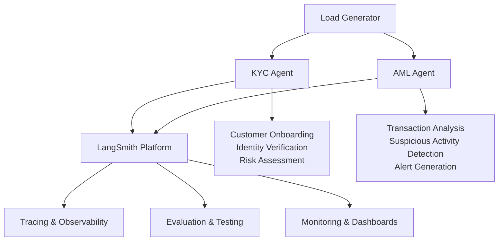

# AML/KYC Financial Services Demo with LangSmith

This demo showcases how LangSmith observability, evaluation, and monitoring capabilities help financial institutions improve their Anti-Money Laundering (AML) and Know Your Customer (KYC) processes. The system includes two main agents: a KYC onboarding agent and an AML transaction monitoring agent, with synthetic load generation to demonstrate real-world scenarios.

## Architecture



## Features

- **KYC Agent**: Customer onboarding with document processing, identity verification, and risk assessment
- **AML Agent**: Transaction monitoring with pattern analysis, sanctions checking, and alert generation
- **Load Generation**: Synthetic customer and transaction data generation for testing and demos
- **LangSmith Integration**: Full tracing, evaluation, and monitoring capabilities
- **LangGraph Studio**: Visual development and debugging environment for agent workflows
- **FastAPI Application**: RESTful API for all operations

## Project Structure

```
deep_agent_finance_demo/
├── README.md
├── requirements.txt
├── pyproject.toml
├── langgraph.json            # LangGraph Studio configuration
├── agents/
│   ├── __init__.py
│   ├── kyc_agent.py          # KYC onboarding agent (function-based)
│   ├── aml_agent.py          # AML transaction monitoring agent (function-based)
│   └── prompts.py            # Shared prompts
├── graphs/
│   ├── __init__.py
│   ├── kyc_graph.py          # KYC agent as LangGraph workflow
│   └── aml_graph.py          # AML agent as LangGraph workflow
├── load_generator/
│   ├── __init__.py
│   ├── customer_generator.py # Synthetic customer data
│   ├── transaction_generator.py # Synthetic transactions
│   └── config.py             # Load generation config
├── app/
│   ├── __init__.py
│   ├── main.py               # FastAPI application
│   ├── routes/
│   │   ├── __init__.py
│   │   ├── kyc.py            # KYC endpoints
│   │   ├── aml.py            # AML endpoints
│   │   └── load.py           # Load generation endpoints
│   └── models.py             # Pydantic models
├── utils/
│   ├── __init__.py
│   ├── langsmith_setup.py    # LangSmith configuration
│   └── evaluators.py         # Custom evaluators
└── tests/
    └── test_agents.py
```

## Installation

1. **Clone the repository** (if applicable) or navigate to the project directory:
   ```bash
   cd deep_agent_finance_demo
   ```

2. **Install dependencies**:
   ```bash
   pip install -r requirements.txt
   ```
   
   Or using `uv`:
   ```bash
   uv pip install -r requirements.txt
   ```

3. **Set up environment variables**:
   Create a `.env` file in the project root:
   ```bash
   cp .env.example .env
   ```
   
   Edit `.env` and add your API keys:
   ```env
   LANGCHAIN_API_KEY=your_langsmith_api_key_here
   LANGCHAIN_TRACING_V2=true
   LANGCHAIN_PROJECT=financial_services_deep_agent_demo
   OPENAI_API_KEY=your_openai_api_key_here
   ```
   
   **Note**: All traces (KYC and AML) will be sent to the `financial_services_deep_agent_demo` project in LangSmith.

## Frontend Interface

This project includes a web-based frontend for managing AML transaction reviews using the deep-agents-ui.

### Quick Start

1. **Start the FastAPI backend**:
   ```bash
   uvicorn app.main:app --reload
   ```

2. **Start the frontend** (in a new terminal):
   ```bash
   cd ../deep-agents-ui
   yarn install
   yarn dev
   ```

3. **Access the AML Reviews interface**:
   - Navigate to `http://localhost:3000/aml-reviews`
   - Or click "AML Reviews" button from the main page

4. **Generate reviews**:
   ```bash
   curl -X POST "http://localhost:8000/load/transactions/anomalies?anomaly_type=sanctions"
   ```

See [FRONTEND_INTEGRATION.md](FRONTEND_INTEGRATION.md) for detailed setup and usage instructions.

## LangGraph Studio

This project includes LangGraph workflows that can be visualized and debugged in LangGraph Studio.

### Starting LangGraph Studio

1. **Install LangGraph CLI** (if not already installed):
   ```bash
   pip install langgraph-cli
   ```

2. **Start LangGraph Studio**:
   ```bash
   langgraph dev
   ```

3. **Open in Browser**: LangGraph Studio will open at `http://localhost:8123`

### Available Graphs

The following graphs are available in LangGraph Studio:

- **KYC Onboarding Agent**: Complete KYC workflow with document extraction, watchlist checking, risk assessment, and decision making
- **AML Transaction Monitoring**: Transaction analysis workflow with pattern detection, sanctions checking, anomaly detection, and alert generation

### Using LangGraph Studio

1. **Select a Graph**: Choose either "KYC Onboarding Agent" or "AML Transaction Monitoring" from the dropdown
2. **Test the Workflow**: 
   - For KYC: Provide `customer_id` and `documents` in the input panel
   - For AML: Provide `transaction` and optional `customer_history`
3. **Visualize Execution**: Watch the graph execute step-by-step with visual node highlighting
4. **Debug**: Inspect state at each node, view intermediate results, and trace execution flow
5. **Edit and Iterate**: Modify the graph structure, prompts, or logic directly in the Studio

### Example KYC Input

```json
{
  "customer_id": "customer-123",
  "documents": {
    "name": "John Doe",
    "dob": "1990-01-01",
    "address": "123 Main St, City, Country",
    "nationality": "USA",
    "id_type": "Passport",
    "id_number": "AB123456",
    "occupation": "Software Engineer",
    "source_of_funds": "Employment salary"
  }
}
```

### Example AML Input

```json
{
  "transaction": {
    "transaction_id": "txn-123",
    "customer_id": "customer-123",
    "amount": 50000.0,
    "currency": "USD",
    "transaction_type": "transfer",
    "origin": "USA",
    "destination": "Canada",
    "timestamp": "2024-01-15T10:30:00",
    "description": "Wire transfer"
  },
  "customer_history": []
}
```

**Note**: When using in LangGraph Studio, make sure to wrap the transaction in a `transaction` key and include `customer_history` (can be empty array).

## Usage

### Starting the Application

Start the FastAPI server:
```bash
uvicorn app.main:app --reload
```

The API will be available at `http://localhost:8000`

### API Endpoints

#### Health Check
```bash
curl http://localhost:8000/health
```

#### KYC Onboarding
```bash
curl -X POST http://localhost:8000/kyc/onboard \
  -H "Content-Type: application/json" \
  -d '{
    "customer_id": "customer-123",
    "documents": {
      "name": "John Doe",
      "dob": "1990-01-01",
      "address": "123 Main St, City, Country",
      "nationality": "USA",
      "id_type": "Passport",
      "id_number": "AB123456",
      "occupation": "Software Engineer",
      "source_of_funds": "Employment salary"
    }
  }'
```

#### AML Transaction Analysis
```bash
curl -X POST http://localhost:8000/aml/analyze \
  -H "Content-Type: application/json" \
  -d '{
    "transaction": {
      "transaction_id": "txn-123",
      "customer_id": "customer-123",
      "amount": 50000.0,
      "currency": "USD",
      "transaction_type": "transfer",
      "origin": "USA",
      "destination": "Canada",
      "timestamp": "2024-01-15T10:30:00",
      "description": "Wire transfer"
    }
  }'
```

#### Generate Customer Load
```bash
curl -X POST http://localhost:8000/load/customers \
  -H "Content-Type: application/json" \
  -d '{
    "count": 10,
    "risk_distribution": {
      "low": 0.7,
      "medium": 0.2,
      "high": 0.1
    }
  }'
```

#### Generate Transaction Load
```bash
curl -X POST http://localhost:8000/load/transactions \
  -H "Content-Type: application/json" \
  -d '{
    "count": 20,
    "suspicious_ratio": 0.1
  }'
```

### Viewing Traces in LangSmith

1. Navigate to [LangSmith UI](https://smith.langchain.com)
2. Select the `financial_services_deep_agent_demo` project
3. View real-time traces of all agent operations (KYC and AML)
4. Analyze performance metrics, costs, and decision-making processes
5. Filter by agent type using tags or metadata if needed

### Running Evaluations

The project includes custom evaluators for:
- KYC identity verification accuracy
- KYC risk classification correctness
- AML detection accuracy
- AML alert relevance
- Compliance check completeness

You can run evaluations using LangSmith's evaluation framework:

```python
from langsmith import evaluate
from utils.evaluators import EVALUATORS

# Run evaluation on a dataset
results = evaluate(
    lambda inputs: kyc_agent.process_onboarding(**inputs),
    data="your-dataset-name",
    evaluators=list(EVALUATORS.values()),
)
```

## Implementation Details

### KYC Agent

The KYC agent performs:
1. **Document Extraction**: Extracts customer information from submitted documents
2. **Watchlist Checking**: Verifies customer against sanctions and watchlists
3. **Risk Assessment**: Calculates risk score based on customer profile
4. **Decision Making**: Approves, rejects, or flags for manual review

All operations are traced in LangSmith with metadata including customer ID, risk level, and decision.

### AML Agent

The AML agent performs:
1. **Pattern Analysis**: Analyzes transaction patterns for suspicious activity
2. **Sanctions Checking**: Checks transactions against sanctions lists
3. **Anomaly Detection**: Identifies unusual amounts, patterns, and geographies
4. **Alert Generation**: Creates alerts with severity levels and recommended actions

All operations are traced with performance metrics and alert classifications.

### Load Generators

- **Customer Generator**: Creates synthetic customer profiles with configurable risk distributions
- **Transaction Generator**: Generates realistic transaction patterns with mix of normal and suspicious activities

## LangSmith Features Demonstrated

- **Tracing**: Full visibility into agent decision-making with `@traceable` decorators
- **Evaluation**: Automated testing of agent accuracy and compliance
- **Monitoring**: Real-time dashboards for performance and cost tracking
- **Feedback**: Human-in-the-loop capabilities for high-risk cases
- **Experiments**: A/B testing different agent configurations

## Testing

Run the test suite:
```bash
pytest tests/ -v
```

## Dependencies

- `fastapi` - Web framework
- `uvicorn` - ASGI server
- `langchain` - LLM framework
- `langgraph` - Agent orchestration
- `langsmith` - Observability and evaluation
- `pydantic` - Data validation
- `faker` - Synthetic data generation
- `python-dotenv` - Environment management

## License

This is a demo project for educational purposes.

## Contributing

This is a demonstration project. For production use, consider:
- Integrating with real watchlist and sanctions services
- Adding database persistence
- Implementing proper authentication and authorization
- Adding more sophisticated risk models
- Enhancing error handling and logging
